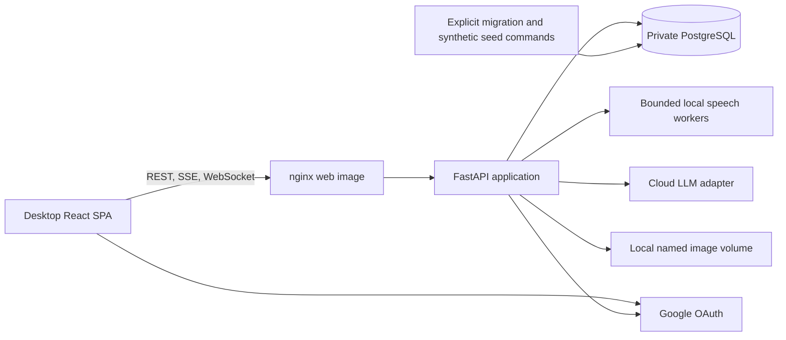
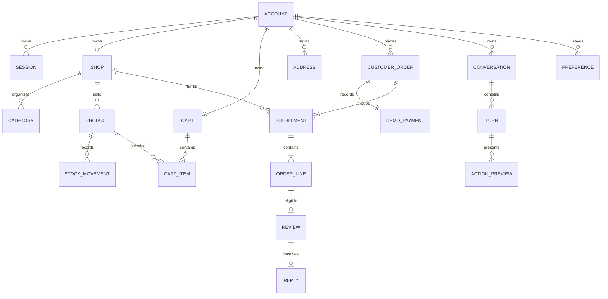
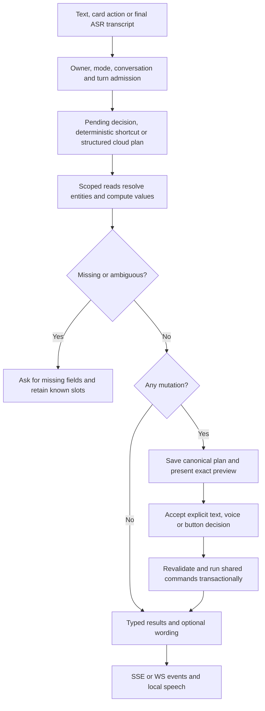
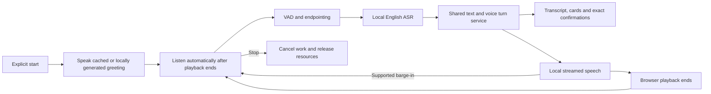

# GroceryGenie implementation plan

**Owner requirements incorporated · Awaiting implementation approval · 8 milestones · 28 tasks**

## 1. Product scope and baseline

GroceryGenie is a public portfolio repository and a functional, synthetic grocery marketplace demo. The differentiator is operating the same customer and seller features through a full-page assistant in Text Mode or hands-free English Voice Mode. Manual browsing and account workflows remain first-class. Final proof includes a reproducible Docker Compose demo, verified engineering checks and recorded measurements.

| Area | Demo scope |
|---|---|
| Identity | Google OAuth only. Anonymous catalog and product information, with sign-in for purchases, account data and assistant actions, review writes and seller operations. Every account can operate as Customer or Seller and manage one shop. |
| Customer | Browse, search, compare, budget recommendations and cheaper alternatives, cart, address book, one multi-seller checkout with simulated INR payment, combined order history and per-shop tracking, delivered-product reviews and explicit preferences. |
| Seller | Own shop and categories, product packages and details, inventory and low-stock alerts, own fulfillment queue, reviews and one reply per review, sales, revenue, gross profit, forecasting, customer purchasing trends and CSV exports. |
| Assistant | Grounded product Q&A and typed, bounded multi-step operations across customer and seller workflows. Every AI write requires confirmation by text, voice or button. Normal website actions use the same domain services. |
| Delivery | Desktop-first liquid-glass React UI. English local ASR/TTS, cloud LLMs, safe degradation if either is unavailable, CPU-compatible Linux images and optional benchmark-qualified GPU acceleration. |
| Out of scope | Real payment or card data, refunds, returns, cancellations and partial fulfillment workflows, external carriers, coupons, complex tax/shipping, administrator/seller-approval/staff features, general-purpose chat, autonomous business decisions, multilingual voice, native apps, PWA/offline, commercial hosting, backup/disaster recovery, on-call and compliance programs. Wake-word activation is optional after hands-free acceptance. |

Work remains on **`audit/project-recovery`**, currently at **`21a3fd479f444f5ec44374fe99dc038a9a3f2379`**, the local `origin/backup/before-wsl-move` tip and direct child of local `main` at `1f9ac11`. Preserve the backup commit and existing audit. These refs were checked locally. The root `models` ignore matches ORM source and no models are tracked in the audited history. Reconstruct a clean target schema using route behavior and the old revisions as reference. The demo has no legacy data or external-client compatibility requirement. Put the fresh Alembic baseline behind a new, clearly named GroceryGenie-only Compose project/database and volume. Rehearse against disposable databases. Keep old development volumes/files and unrelated resources out of setup and reset. Existing data does not block recovery.

The [audit](PROJECT_AUDIT.md#baseline-verification) recorded failed backend import/migration, Ruff, Mypy, default frontend build and `make check`. The partial backend test run recorded 27 passed, 29 failed and 9 collection errors. TypeScript, direct Vite and Docker assembly checks passed for the audited build paths. Live workflows and latency were unverified. Its 57 issues remain mapped below. This revision changes the plan only and makes no new runtime claims.

## 2. Architecture and technology choices

| Decision | Original problem | Selected design and remaining trade-off |
|---|---|---|
| Application and state | Routes and tools execute different business rules. Redis is another source of conversation truth, full-list cache invalidation is costly and optional runtimes impede boot. | One FastAPI/Uvicorn modular monolith and one PostgreSQL database for domain data, auth, turn state and confirmations. Use indexed queries and bounded pools first. In-memory admission is limited to one API process initially and carries no durable correctness state. Speech work uses separately bounded processes so its load stays away from the API event loop. |
| Identity | Email heuristics and development impersonation could grant broad seller access. App JWTs lacked straightforward revocation. | Google OIDC through a patched Authlib integration, Google `sub` scoped to verified issuer, and one opaque random session per login, hashed in Postgres. An indexed lookup enables revocation and mode checks. An account owns one shop and may switch modes intentionally. Ownership, action role and object/child scope are enforced independently. No membership administration is needed. |
| Commerce | Duplicated checkout, negative quantities, lost stock deltas and global seller order state. | One transaction for one customer order, one simulated payment and one fulfillment per seller. Separate seller and customer projections. Use immutable line and cost snapshots. This introduces a parent/child relationship but preserves a simple four-state seller flow. |
| Search | Unordered substring ranking, stale vector readback, blocking Qdrant calls and unused graph reads. | PostgreSQL constraints, typed filters, weighted full-text search and measured trigram/SKU/name ranking. Remove Redis, Qdrant, Neo4j, embeddings, MCP, index sync and aisle graph setup from the release. Search can miss implicit semantic associations. Use synonyms, structured fields and a labeled eval before considering additional infrastructure in a future scope. |
| Agent | Free-form parameters, duplicated turn runners and client-directed approvals permitted unsafe effects. | One schema-validated planner/executor with deterministic shortcuts, bounded read chaining and a server-side write preview. Use shared domain commands and typed results. Ambiguity costs a follow-up rather than permitting a guessed write. |
| Cloud providers | Per-provider retries and connection timing lacked a total budget. Provider compatibility and charges varied. | A thin OpenAI-compatible adapter with configurable endpoint capabilities and strict local validation. Moonshot and DeepSeek are target adapters to qualify. Use JSON mode where supported and validate locally. A provider or model label alone does not establish JSON Schema enforcement, streaming usage or remote cancel. [DeepSeek JSON output](https://api-docs.deepseek.com/guides/json_mode/) |
| Media | One WebSocket receive loop waits on the full turn. ScriptProcessor, raw fallback bytes and unbounded playback make interruptions and reconnect fragile. | AudioWorklet, typed protocol, independent I/O, generation fencing and a bounded local speech pool behind an adapter. Measure CPU and optional GPU before selecting engines. Start with cooperative cancellation where supported and contain remaining native work. A dedicated killable worker slot is justified only where tests and measured capacity support it. |
| Frontend | Handwritten response drift, global redirects, eager unminified routes and unused query provider. | Retain React, Vite, React Router, Tailwind and the liquid-glass design. Use a typed Fetch client, TanStack Query for actual server state, URL filters, semantic UI and split feature routes. Keep local/URL state and a narrow theme preference. Remove Axios and redundant state/tooling where no longer used. |
| Deployment | Startup seeded and wiped services, CPU dependencies diverged from lock, nginx WS upgrade was malformed. | One Compose stack, isolated local database, pinned API and web images, explicit migration/seed commands and optional voice runtime. Default voice profile runs on CPU. One lightweight gateway serves SPA and same-origin API. No paid collectors or host dependency installations for normal deployment. |

Retain Python 3.12, uv, FastAPI/Pydantic, SQLAlchemy async/asyncpg, Alembic, PostgreSQL 16 on a supported patch, nginx, Docker Compose, and the React stack. Keep one tested ASGI server. Node 22 is the starting line for tooling and the frontend builder. Pin the supported patch and verify ESLint, TypeScript and plugin peers together. Browser/API, API/database and voice wire contracts are the architectural boundaries. A single package can hold several domain modules without repository interfaces for each query. [Vite 8 prerequisites](https://v8.vite.dev/guide/), [ESLint 10 requirements](https://eslint.org/docs/latest/use/migrate-to-10.0.0), [typescript-eslint ranges](https://typescript-eslint.io/users/dependency-versions/)



The API image owns core code. Keep speech dependencies and model assets outside its minimal runtime if the chosen engine needs a separate profile or image. Use one optional private speech service at most, with a bounded warm pool and separate admission. The documented full demo runs voice on CPU, with explicit model setup where needed. The core-only configuration remains usable without speech. Only the web listener is exposed locally by default. Loopback is the default for the demo. Remote use needs HTTPS and exact OAuth callbacks. Cloud outages affect assisted natural-language operations, while manual commerce and local deterministic assistant cards continue where their dependencies permit.

```text
backend/
  app/
    main.py, core/                  # wiring, configuration, error/auth helpers
    api/                           # REST, SSE, WS, request and response schemas
    identity/                      # Google OIDC, sessions, modes and shops
    catalog/                       # products, categories, search, food facts, images
    commerce/                      # cart, checkout, inventory, orders, fulfillment
    accounts/                      # addresses, ratings, replies, preferences
    reports/                       # scoped aggregates, forecast, CSV
    agent/                         # plan, registry, executor, confirmations, providers
    voice/                         # stream protocol, turns, speech adapters
    db/models/, db/migrations/     # tracked ORM and fresh revisions
    cli/                           # explicit seed and model setup
  tests/{unit,integration,contract,agent,voice,e2e}/
frontend/src/
  app/, shared/{api,ui}/, features/{catalog,checkout,account,seller,assistant,voice}/
deploy/                            # Dockerfiles, nginx, optional speech profile
scripts/                           # Python checks, smoke, dataset and benchmarks
.github/workflows/                 # verification, image scans and publication
docs/                              # audit, plan, setup, evidence and change logs
```

### Identity and data boundaries

Use Google authorization code login with state, nonce, exact configured redirect and issuer, audience, subject and expiry checks. Use PKCE where supported by the selected Google/Authlib flow. Rotate locally issued session tokens on login, expire and revoke on logout, keep OAuth state short-lived and separate. Mark cookies HttpOnly and SameSite with Secure on HTTPS and a narrowly scoped loopback development setting. Validate Origin and CSRF on cookie-based writes, authenticate/authorize sockets before upgrade, avoid URL tokens, revalidate session and mode before protected effects and close stale voice sessions. An account may create or open its own shop upon switching to Seller. A role change invalidates pending actions from the old mode and the browser clears/rekeys customer/seller query caches. Server derives shop ID from principal. Customer order queries use customer ownership. Seller fulfillment queries and updates require shop ownership of the child record and shape only child items, subtotal, approved delivery fields and status. A seller can use Customer mode for their own purchases. [Google OIDC](https://developers.google.com/identity/openid-connect/openid-connect)



The schema uses UUIDs, UTC-aware timestamps, unique shop-per-account, one cart per account, cart/product uniqueness, positive integer package quantities, nonnegative stock/cost/price and unique child per order/shop. Use INR paise for exact arithmetic and explicit formatted display. Enforce shop consistency with composite keys where practical and validated locking transactions elsewhere, including category ownership and fulfillment-line shop consistency. Snapshot name, SKU, package, sale price and unit cost on each line, and store the normalized delivery snapshot on the parent. Record actor, delta and reference for stock movements. Reviews are allowed for delivered purchased lines, one per line, and each has at most one reply from the owning shop. Addresses, conversations and preferences use owner-scoped reads/writes. Default address selection and promotion are atomic.

### Shared business operations and multi-seller checkout

REST handlers and approved tools validate DTOs, derive the actor from authenticated context, and call the same scoped application commands/queries. Commands own a short PostgreSQL transaction and return a typed result referencing any committed effect. Read operations publish bounded, explicitly projected result shapes. Public catalog returns active products only. Seller detail, order, reports and review replies each use own-shop scope.

1. The customer reviews a versioned cart of integer packages across shops, selects or adds an address, and requests a server-computed quote. The quote contains cart version, address/version and snapshot, exact lines/prices, shops, per-shop totals and combined INR total with an expiry. The UI and assistant label payment as simulated. The manual final checkout click submits the quote with an idempotency key. The AI requires confirmation of the exact preview before submitting it.
2. Claim the idempotency key scoped to account and operation, lock the cart then the relevant product rows in stable ID order, and validate the quote, ownership, address, product status, price and stock. Recheck current quantities and totals. In one transaction, insert the parent, one simulated payment record, child fulfillment rows, immutable order lines and stock movements, decrement stock and clear the affected cart, then record the result. A failed line rolls back every seller's part and keeps the cart. Stale quotes return a typed refresh requirement and need a fresh review and confirmation. Same key plus same fingerprint returns the saved outcome even if the original response was lost. Different inputs with the same key conflict. Distinct keys cannot double order the same quoted cart version. [PostgreSQL row locking](https://www.postgresql.org/docs/16/explicit-locking.html)
3. Stock remains available until checkout commits. Seller add-stock has one simple positive quantity input. Absolute corrections, if supplied by a seller or AI, carry an expected stock/version so they cannot overwrite a concurrent checkout. Bulk edits use an explicit bounded ID list and one transaction for compatible commands. Status advances exactly one step through `placed → packed → out_for_delivery → delivered`, using a guarded version/state transition and an actor/timestamp record. Packing does not deduct stock again. Parent view shows child states and a derived summary, while each seller sees and updates their child alone.
4. Use typed APIs for `/auth`, `/me`, `/products`, `/cart`, `/checkout/quotes`, `/orders`, `/me/addresses`, `/seller/*`, `/conversations/*` and the voice socket. Keep routes under one internal version. Publish OpenAPI-derived TypeScript and shared SSE/WS schemas. Keep seller cost snapshots out of buyer and public responses. Move the SPA and API together in the new release. Use stable cursor/order keys, scoped error messages and a request ID without private internals.

### Seller reporting

Deliver daily, weekly, monthly and yearly date buckets (Asia/Kolkata dates, ISO week starts on Monday, UTC storage), total orders/units, delivered sales/revenue and gross profit (`sum((unit sale price − unit cost) × quantity)` from snapshots). Distinguish pending activity from recognized demo sales and use exact INR amounts. Show best-selling products, configurable product-level or app default low-stock thresholds, order status and seller-owned ratings/replies. Show repeat-purchase rate and aggregate purchase trends without customer identities, addresses or cross-shop data. Include daily UTC-aware date spans converted from chosen local dates in the report contract. Make CSV the initial export with stable headers and spreadsheet-formula-safe text. The report tool returns the same results and a scoped CSV download via existing API rather than copying report calculations.

Use a simple rolling mean of recent complete weekly sales or revenue buckets for a short-horizon baseline forecast. Require at least eight complete weeks, display method, time range and insufficient-data state, and label synthetic demo history and resulting forecasts. Measure error with a small held-out synthetic series as a sanity check. Forecasting remains deterministic SQL/Python. Profit here is gross margin from product cost, excluding taxes, overhead and shipping.

### Search and food information

One SQL query service filters before ranking or limit. Allowlist product name, active state, category, brand, min/max unit package price, total budget, requested package quantity, normalized package size/unit, stock, ratings, structured dietary attributes and known allergen flags. Keep price per package versus basket budget explicit. Use parameterized queries, exact normalized name/SKU boosts, weighted FTS/GIN and trigram indexes where the benchmark helps. Use real availability (stock ≥ desired quantity) and stable tie-breaks. Recommendations and comparisons use SQL candidates and exact Python/SQL price arithmetic, with transparent ranking from current budget, explicit preferences and optionally the signed-in customer's own purchase history. Offer substitutes as choices. [PostgreSQL text search indexes](https://www.postgresql.org/docs/16/textsearch-indexes.html), [PostgreSQL trigrams](https://www.postgresql.org/docs/16/pgtrgm.html)

Seller forms and tools store ingredients, dietary tags, allergens and cross-contact, nutrition quantities with units/basis, provenance and completeness explicitly. Record whether fields came from demo seed or seller-entered label data. Treat empty/unknown separately from recorded absence and never derive safety from prose, another product, embeddings or an unspecified label. Warn sellers when omissions reduce filtered visibility/recommendation eligibility. Product answers use selected typed fields and field/source citations, with unknown stated plainly. Deterministic rendering handles core facts. Natural phrasing can use sanitized fields while write outcomes remain authoritative structured output.

## 3. Shared multi-step assistant



### Planning and operation coverage

- One registry entry per real operation declares action name, direction, strict input/result schema, allowed mode, scope, read/write status, and error contract. Tools call shared domain services with context-derived actor and allowed targets. The model has no SQL, filesystem or business-write access outside the registry. Query tools expose safe filter types. Use a bounded declarative plan, schema-validated locally with explicit command discriminators. Starting limits are at most five typed steps, approved dependencies on earlier results, bounded results and bulk targets (initial maximum 20 explicit targets), no loops, recursion, arbitrary field references or code generation. Cap time and size independently of steps.
- Typed UI actions and exact follow-ups, selected result IDs, cancel/confirm and eligible deterministic commands use zero cloud calls. Most free-text requests use one structured planning call. Allow one additional bounded call for genuine ambiguity recovery, schema repair or wording only if within the turn and spend budget. A provider fallback also counts toward the same cap on calls, with default two total attempts per turn. Entity resolution and calculations use database results and Python. When a search returns several plausible matches, ask which result was intended. An unavailable product yields in-stock alternatives and a new choice, with no automatic substitution. Keep known slots and identify exactly what is missing, including budget scope, package size, quantity, full address and seller target. Unsupported topics receive a short GroceryGenie-oriented response.
- Initial coverage includes customer search, comparison, recommendations, alternatives, product answers, budget, cart reads/writes, quote/checkout, order and child status, address CRUD, ratings/reviews and explicit preferences. Seller tools cover own shop category/product creation/edit/deactivate, price and stock updates, low-stock and inventory checks, order queue/detail/advance, review reads/replies, reports/CSV and grouped edits. Settings handles role switching and the assistant may direct the user there. Maintain a route/tool parity checklist and name any browser-only file picker or setup operation clearly.
- Example chains are search → choose or resolve exact product → calculate two-package cost → preview cart addition, and list pending fulfillments → resolve explicit seller child → preview `placed → packed`. Compare/recommend uses multiple reads without confirmation. A combined compatible bulk stock adjustment uses one write group and one exact preview. If a workflow requires distinct irreversible writes or new facts after a commit, pause at a separate preview. E.g. separately confirm saving an address and placing the order after the exact quote is presented. Stop dependent steps after failure. Keep successful reads and effects accurately represented. No automatic retries of an uncertain write without its existing idempotency key.

### Confirmation, session state and privacy

- All AI writes wait for explicit confirmation, including cart edits, checkout, saved preferences, address changes, reviews, stock, product and fulfillment operations. Summarize exact products/IDs as user-facing names, quantities, prices, totals, target shop/order and effects. For addresses, collect only missing fields, then read back and show the complete proposed address from local data before saving. The server stores immutable commands or quote, payload fingerprint, actor, authenticated session or mode version, conversation ID, target versions and expiry (initially five minutes). Client buttons provide only preview ID and decision. Text/voice accepts an explicit positive response only when a single matching preview has been presented. A rejection, new plan, changed mode, expired or changed data invalidates it. Voice confirmation binds to the presented generation and waits for the relevant preview to be heard or explicitly selected in UI.
- Keep at most one active turn per conversation via a small Postgres turn claim with a bounded expiry and generation/version checks. Distinct conversations can run independently. Hold no DB transaction over provider, media or streaming work. On confirmation, recheck claim, owner, mode, preview, target versions and capabilities. Consume the preview and persist its result with the domain effect in one transaction for the compatible group. Replays return the original committed outcome. A cancelled turn invalidates pending work before any new mutation can start. If interruption overlaps the transaction boundary, resolve via the persisted outcome. A committed effect remains committed and the client receives its typed result even when response generation, SSE or playback fails.
- Store thread/turn messages scoped to the user with bounded context, stable pagination and time-limited drafts. Text and Voice Mode reopen the same authorized conversation. Expose list, resume and delete for conversations and view/update/delete for saved preferences. Save a preference only after an explicit request and confirmed write. Use owned order aggregates locally for recommendations. Keep raw audio in bounded transient buffers. Collect exact address fields locally using typed forms or a guided voice capture state and deterministic/local validation, using redacted placeholders or field labels for any cloud request. Avoid sending account identity, addresses or raw notes. Redact sensitive free text as a defense in depth, with no guarantee for arbitrary unsolicited inputs. Avoid private contents in ordinary logs and shared exports, and use shortened/masked history for sensitive address turns.
- Use versioned event types for status, transcript, clarification, options, preview, delta, committed effect, error and terminal outcome. Include conversation/turn ID, sequence and generation. The source of truth on reconnect is owned conversation and stored effect state. Replay a compact committed snapshot or continue the active view without resubmitting a mutation. Typed product/shop result variants replace key-presence heuristics.

### Provider controls and low-cost verification

One validated server-side configuration describes endpoint, secret reference, model, verified structured output and streaming features, connect/idle/total timeouts, output/token cap, retry and fallback policy and cost metadata. Test with two configured OpenAI-compatible providers using mocks and qualify live Moonshot/DeepSeek capabilities only when configured and within the verification budget. Strict local schema and policy validation applies to every provider. Fallback only before visible output for eligible transient failures and only to explicitly configured endpoints. Close abandoned HTTP streams promptly, cap total turn time (initially 12 seconds outside explicit user follow-up), bound per-account and global concurrency, and report actual request count, input/output tokens (or unavailable) and estimated usage cost when prices are configured. Live requests are opt-in and stay out of boot and CI.

Automated tests use deterministic providers. A local smoke command requires an opt-in flag, explicit max calls/tokens and a cost ceiling. Initially budget at most **$0.50 of the approximately $7 remaining credit** for small controlled development/final verification combined, subject to actual provider prices and an explicit local run. If safe price or balance is unknown, keep that test disabled until an upper bound can be set. Record actual calls and estimates without collecting keys, inputs, prompts or PII in reports.

## 4. Hands-free English voice



- Request microphone and resume Web Audio on explicit user start. Show greeting, listening, speaking detected, transcribing, thinking, speaking, interruption, silence, overloaded and stopped states. Default to hands-free listen-after-playback, including after an action preview. Request browser echo cancellation/noise suppression where available. Use AudioWorklet capture with bounded backpressure and resample to mono PCM16 at 16 kHz for inference where required. Encode turn generation, sequence, direction and negotiated sample rate for audio. Use the same framing for fallback speech as normal speech. Browser reports actual playback completion. Headphones, echo checks, timeout and push-to-talk/manual stop are fallbacks. Keep text usable during microphone, model or permission problems. [AudioWorklet](https://developer.mozilla.org/en-US/docs/Web/API/AudioWorklet)
- Authenticate and validate Origin, mode and owned conversation before WebSocket upgrade. Separate frame reader, bounded turn/model work and one writer. Limit frame size, buffered utterance, concurrent sockets/model slots, output queue and idle/heartbeat time. Enforce one active voice generation per connection. Use timeouts for stalled clients, reclaim DB connection scopes early, and make reconnect resumable from the server-issued conversation with capped, cancellable attempts. On stop, route exit or logout, close the socket and release tracks, worklet, playback sources, AudioContext, buffers and retry timers.
- Implement immediate local stop and generation invalidation as required baseline. Natural barge-in is conditional on echo and accuracy measurements. For it, monitor bounded inbound frames during playback, accept sustained speech with echo suppression, stop playback, invalidate output and use captured speech as the next turn. Cancellation propagates through all active work. Use native cooperative cancel where measured or bounded isolated child termination and warm replacement where feasible. A cancelled thread await does not stop already running native work. For noninterruptible intervals, bound work, discard stale results and report compute completion separately. Close cloud streams and measure response locally. Claim remote compute or billing termination only when the provider verifies it. Confirmations and durable commit receipts follow section 3. [Python Future cancellation](https://docs.python.org/3.12/library/concurrent.futures.html#concurrent.futures.Future.cancel)
- Evaluate Parakeet ONNX and a small English Whisper implementation such as faster-whisper INT8 in comparable CPU modes, then the best justified CUDA configuration. Compare simple RMS with a lightweight speech VAD such as Silero if background noise or false starts warrant it. Compare Piper with a lightweight alternative such as Kokoro ONNX using actual time to first audio, naturalness, startup/RSS and correctness. Evaluate engine, model and voice licences independently and pin upstream artifacts/checksums. Bundle redistributable artifacts with notices only when terms are verified. Use a documented opt-in model fetch or local mount when bundling lacks verified permission. Keep CPU usable with the chosen engines. Optional GPU depends on a validated Windows NVIDIA driver/WSL GPU passthrough and the Docker/runtime-specific setup. Users need no host app dependency install for default CPU. [onnx-asr](https://github.com/istupakov/onnx-asr), [faster-whisper](https://github.com/SYSTRAN/faster-whisper), [Silero VAD](https://github.com/snakers4/silero-vad), [Piper](https://github.com/OHF-Voice/piper1-gpl), [Kokoro ONNX](https://github.com/thewh1teagle/kokoro-onnx), [Docker Desktop GPU on WSL2](https://docs.docker.com/desktop/features/gpu/), [ONNX Runtime GPU matrix](https://onnxruntime.ai/docs/execution-providers/CUDA-ExecutionProvider.html)

## 5. Implementation milestones and exact tasks

Each milestone ends with runnable checks and focused Conventional Commits on the existing branch. Effort labels are relative (S small, M medium, L large). Dependencies describe implementation gates. Interface sketches, fixture work and benchmarks may start sooner when independent. Audit IDs are listed in the traceability matrix, which also explains exclusions.

### M0. Rebuild the baseline and make it reproducible

**Gate:** The fresh target schema and checked core build run in a clean GroceryGenie-only project, with no boot-time seed side effects.

| Task | Work, dependencies and scope | Acceptance and evidence |
|---|---|---|
| R01. Recover ORM and initial schema | P0/L. Start at current branch. Use the audited revisions and import sites as reference. Narrow `.gitignore`, create tracked models in `backend/app/db/models/`, and establish the new Alembic baseline in a new named project DB. Move superseded migration design to Git history if needed. | Imports resolve from a clean checkout. Blank PostgreSQL upgrades to head. Alembic schema check finds no unexpected differences. Startup handles unprepared schema clearly and touches no old DB. |
| R02. Portable quality tools and dependency locks | P0/M. Start with R01 in parallel, gate on core smoke. Replace PowerShell-only recipes with Linux/Compose commands backed by Python scripts where useful. Pin uv, Python, Node and exact locks. Reconcile lint/format/strict typing, remove duplicate or dead checks only when replaced or unused, add fast pre-commit. Log package changes and fix build contexts. | Fast hook runs applicable nonmutating checks, dev and container install use exact locks, all enabled lint/config checks are zero-error and zero-warning. Validate Git status before/after. No duplicate or blanket lint/typing suppression. |
| R03. Explicit migrations and deterministic demo data | P0/M. R01, ties into R07–R11/R13 fixtures. Replace `prestart.py` and reset/seeding flow with explicit commands. Generate ~10,000 realistic synthetic packages across shops, categories, brands and dietary fields with repeat customers and ≥8 full weeks of useful sales history. Separate small deterministic CI fixtures from full showcase dataset. | Seed twice by stable keys without duplicates or overwrites of edited data. Restart preserves sentinel records. New project volumes are uniquely scoped. Bench confirms fixture row counts, consistent INR/cost snapshots and clearly labeled synthetic history. |

### M1. Close identity and transport boundaries

**Gate:** Google-only login, role switching and owned resource rules pass a two-account isolation matrix. Legacy insecure write/approval routes are removed or unavailable until replacements pass.

| Task | Work, dependencies and scope | Acceptance and evidence |
|---|---|---|
| R04. Google login, sessions and owned shops | P0/L, R01–R02. Replace old auth/role endpoints via `identity/`, config and routes. Implement OIDC state/nonce, scoped callback, opaque token with revocation and session mode, one owned shop, settings switching and isolated fixture auth for tests only. | Mock OIDC contract covers valid, stale and invalid claims/sessions. Seller mode is available to both accounts with distinct shops. Logout/mode changes invalidate stale operations. Final local Google acceptance covers callback and browser session flow. |
| R05. Scoped capability and safe entry points | P0/M, R04. Add shared actor and own-object queries, allowed host/origin/CSRF and bounded HTTP/WS/auth/provider/admission limits. Remove old development login, URL tokens, role heuristics, raw traces and client-provided tool approval paths. Restrict secret injection and per-seller/account payload scope. | Two customers/two shops cannot access each other's private order, chat, checkout, address, inventory or writes through any entry point. Invalid origin/session fails before WS acceptance. Logs, errors and static assets contain no keys or private trace content. |
| R06. Typed contracts, error mapping and image handling | P0/M, R01, R04–R05. Define stable API DTOs, problem codes, OpenAPI/TypeScript agreement and SSE/WS event schema. Decode/re-encode bounded raster uploads, validate bytes/pixel budget, use opaque media names and web-relative asset URLs. | Generated or independently contract-checked frontend schemas match server. Unknown enum/event fails safely. Oversized/malformed uploads are rejected, valid images display behind nginx and no active/dangerous file types are served. |

### M2. Shared commerce and seller operations

**Gate:** A buyer can order from two shops in one simulated payment. Sellers fulfill separately and view only their own data. Reports reconcile with immutable lines and review replies are scoped.

| Task | Work, dependencies and scope | Acceptance and evidence |
|---|---|---|
| R07. Owned catalog, package inventory and bulk actions | P0/L, R01, R05–R06. Replace duplicated product/tools with `catalog/` and `commerce/inventory`. Add categories, brand, package, paise price/cost, food fields, active state, stock threshold, positive stock-add and guarded corrections/bulk operations. | Concurrent stock updates and checkout reconcile without lost deltas. Invalid quantities/negative monetary data rejected in API and DB. Unknown/foreign target fails a bulk group without partial changes. Public details exclude inactive products. |
| R08. Multi-shop cart, quote and simulated checkout | P0/L, R07 plus address contract R10, R06. Add one shared transaction in `commerce/` and forms/tool adapter. Introduce versioned quote, one simulated payment and atomic parent + child + line + inventory writes, idempotency and stale quote errors. | Separate DB connections contend on last units. Exactly one admissible order commits per available stock/quote. Same key replays one receipt, mismatched key conflicts, different keys cannot duplicate a quoted cart, and second-shop failure rolls back checkout, payment, stock and cart changes. |
| R09. Fulfillment and order projections | P0/L, R05, R08. Separate customer parent/child views and seller own-child routes/commands. Build strict state machine, timestamps and order history. | Buyer sees combined total and distinct seller states. Seller never sees other child rows, costs or status. Reverse/skipped and competing transitions fail predictably. Replays preserve one event and stock is unaffected by packing. |
| R10. Address book, reviews and seller replies | P1/M, R04–R06. Address work ships before R08. Review/reply needs R09’s delivered-order contract. Add typed street/city/state/PIN/contact fields, scoped defaults and versioning, delivered-line rating/review uniqueness and one owned reply. | Concurrent default changes leave consistent default state. Invalid purchase/status and foreign replies are refused. A race creates one review/reply, aggregate count and score match SQL, equal timestamps still paginate correctly and editing an address cannot alter order snapshots. |
| R11. Analytics, cost snapshots and CSV | P1/L, R07–R10. Create `reports/` with seller SQL/Python calculations, calendar buckets, profit, forecasts, repeat purchase trends and CSV. Align stock alerts and review management with seller dashboard. | Independent fixture totals match all supported date buckets and gross margins across >100 items and two shops. Check sparse history and currency precision. CSV has deterministic header/order and safe cells. API, UI and tool report values agree. |

### M3. Correct search and factual product information

**Gate:** Common natural-language searches and manual filters return eligible, ranked products from current PostgreSQL data. Ingredient and allergen unknowns are explicit.

| Task | Work, dependencies and scope | Acceptance and evidence |
|---|---|---|
| R12. Shared ranked PostgreSQL search | P1/L, R06–R07. Implement `catalog/search`, typed allowlists, deterministic exact/name/SKU plus FTS and benchmarked trigrams. Filters apply before result cap. Use the same path for browse, agent search, alternatives and recommendations. Remove Redis full-list cache, Qdrant/vector synchronization, embeddings, graph code and MCP from target runtime. | Versioned ≥100-query corpus covers owner examples, accents/spelling, package quantity, budget and zero hard-filter violations. Validate seller/private constraints, empty queries, deactivation and EXPLAIN and timing at 10,000 products. |
| R13. Structured facts, search eligibility and factual Q&A | P1/M, R06–R07, R12. Implement forms/DTOs for dedicated ingredients, nutrition units/basis, diet, allergens, cross-contact and label provenance. Warn on incompleteness, add deterministic answers and safe optional phrasing. | Unknown does not equal absence. Conflicting or absent labels abstain, prohibited/inactive products do not appear, seller free text cannot override facts, customer sees the evidence field or explicit unavailable answer. |

### M4. One bounded multi-step assistant

**Gate:** Text mode completes representative multi-step tasks with exact confirmed writes and readable structured results. Voice can reuse the same turn entry without changing authorization.

| Task | Work, dependencies and scope | Acceptance and evidence |
|---|---|---|
| R14. Typed planner, dispatcher and tool coverage | P0/L, R05–R13. Replace duplicate `orchestrator`, old fast path/raw tool dispatch and heuristic formatter with one turn flow. Implement exact shortcuts, server validation, bounded reference resolution, clarification and tool parity. Route writes through R15. | Product-under-budget → choose → preview, search→compare/recommend, seller filter→status preview, grouped stock delta and address follow-up work under mocked LLMs. Unknown steps, attempted scope expansion, invalid references and too-long plans have safe outcomes. |
| R15. Turn claims, approval and receipts | P0/L, R04–R06, R08–R10 and R14 interfaces. Replace Redis pending locks with owned short DB transactions, one active turn claim, immutable server approvals, scoped idempotency and typed receipts. | Every tool mutation requires approval. Text/buttons/voice reach the same policy. Forged/expired/replayed approvals, stale versions, old mode, races across transports and cancellation near commit are exercised. At most one valid effect, with exact receipt recoverable after response/playback failure. |
| R16. Cloud LLM adapters and metering | P1/M, R02, R05–R06, R14 interfaces. Replace loose configs and layered retries. Add capability-aware Moonshot/DeepSeek-compatible adapters, strict schemas, deadlines, fallback, secret isolation and usage tracking. | Direct actions cost 0 calls. Most corpus cases resolve in one call. Fault tests cover timeout, malformed outputs, partial stream, exhaustion and retry/fallback budgets. CI never uses cloud keys. Run small local opt-in smoke and record real call/cost data when available. |
| R17. Shared history, preferences and safe personalization | P1/M, R05–R06, R10, R14–R15. Implement owned conversation lifecycle, explicit preference tools/UI, bounded context, masked address collection and local purchase-derived suggestions. | Text/voice reopen one conversation. Delete views remove effective prompt context/data. No implicit fact saving or raw mic persistence. Privacy fixtures verify typed address fields stay local and cross-account attempts fail. |

### M5. Hands-free local voice

**Gate:** Real local models carry out the full greeting/listen/respond loop and one confirmed mutation. Stop, cleanup and bounded overload are verified on desktop. Barge-in remains conditional on a measured echo/cancellation gate.

| Task | Work, dependencies and scope | Acceptance and evidence |
|---|---|---|
| R18. Choose and package speech engines | P1/L, R02. Can benchmark early alongside commerce. Build reproducible Python evaluation harness for ASR/VAD/TTS comparisons in section 4. Record engine/model provenance and artifact licences. Reuse Parakeet/Piper code selectively if measured winners. Isolate media dependency graph and choose only the supported CPU models plus optional proven GPU profile. | Record quality, first-audio latency, real-time factor, warm/cold startup, RSS/VRAM and throughput under one and five sessions. Document selection and fallback. CPU clean container runs with the approved mounted or bundled assets. No overlapping ORT package providers in an environment. |
| R19. Authenticated voice transport and cancellation | P0/L, R05–R06, R14–R18. Replace `api/ws.py` loop with bounded reader/session task/writer, audio rate/envelope, speech slot admission, idle close and propagation of generation/cancellation. Use same agent events and approval logic. | Real PCM framing, fallback alignment, short DB scopes and 101 through nginx. Fault tests exercise slow clients, logout, malformed frames, worker failure, cross-owner reconnect, cancel during ASR/LLM/TTS and commit effects. Benchmark which local work actually stops and record any provider limitation. |
| R20. Browser hands-free session and lifecycle | P1/L, R06, R18–R19. Replace legacy `VoiceSessionContext` capture/retry code. Implement mode start, greeting, automatic listen after real playback, echo-aware VAD, status/captions, stop and reconnect. Qualify optional barge-in without risking accidental confirmation or self-transcription. | A desktop user completes multiple turns and an action confirmation after a single start gesture. Recover from silence/permission failure with text fallback. On stop/logout/navigation, zero stale playback/reopen and audio/transport resources reclaimed. Barge-in enabled only with documented local stop and echo results. |

### M6. Complete the desktop-first liquid-glass UI

**Gate:** Manual customer and seller journeys and both assistant modes work through production-like nginx on desktop. Keyboard focus, query consistency and failure states are exercised.

| Task | Work, dependencies and scope | Acceptance and evidence |
|---|---|---|
| R21. Application shell, query and routing | P1/M, R04–R06. Retain visual identity. Build `app/` route tree and feature modules, typed Fetch/TanStack Query, abortable requests, scoped state, local errors, 404 and minified route splitting. Keep source maps private if generated. | No earlier account or mode data flashes on switch/relogin. Filters survive deep links/back navigation. Slow requests cannot overwrite new results. Accessible sidebar/dialog/routing and actionable retry states tested. |
| R22. Manual customer and seller journeys | P1/L, R07–R13, R21. Implement catalog/search/detail, cart/review/checkout, order child views, address/review flows and seller own-shop categories, inventory, orders, analytics and reply pages. Clearly label simulated payments, seed data and forecast. | Playwright’s two-account/two-shop journey completes manual order, fulfillment and review/reply. Reports/CSV available and match server. UI states cover empty, loading, failure, low stock, changed quote and partial dependency outage. |
| R23. Assistant page, structured results and mode parity | P1/L, R14–R17, R20–R21. Build Text/Voice chooser and full-page thread, cards, comparisons, reports, exact confirmation preview/transcript and committed-effect receipt. Share results and history across modes. Preserve accessible controls for no-microphone use. | Customer and seller can perform all in-scope tool flows. Keyboard and typed/button approvals work. Voice tests cover greeting and listen-after-playback. Cancellation/failure after commit retains the authoritative result. Targeted frontend coverage for risky state transitions. |

### M7. Reproducible packaging, evidence and final delivery

**Gate:** Clean clone runs verified CPU images and full demo, automated gates pass, benchmarks and exceptions are documented, and the recovery branch is ready for one owner-approved final PR.

| Task | Work, dependencies and scope | Acceptance and evidence |
|---|---|---|
| R24. Compose CPU default and optional GPU | P0/L, R02–R06, R18–R20 for media. Use pin-locked multi-stage builds, a private network/volumes, explicit migration and seed, unprivileged processes where possible, correct SSE streaming and WS upgrade and feature health. Do not reuse shared old volumes. Only optional GPU profile uses host driver/runtime. | Fresh named Compose project boots and probes pass, app containers receive only needed secrets, only expected web port exposed, ordinary commerce survives voice/cloud outages. Cold CPU image works on Linux without host Python/Node/CUDA. Measure image pulls/size, model setup and fresh install. |
| R25. CI, security scans and GHCR publication | P0/L, R02, R06, R24. Add GitHub Actions tests/coverage and exact checked builds. Scan runtime, resolved dependencies and every published app/media image. Publish only successful, scanned build content from trusted branch workflow using scoped token. | No test needs cloud LLM keys or GPU. DB tests run against real Postgres. CI logs are redacted. Image scan reports, source SHA, tags and digests traceable. Smoke-tested Compose references published CPU content. |
| R26. Local media, provider, load and stress verification | P1/L, R03, R08–R25 as applicable. Add Python launch/eval scripts and run real projects on specified WSL2 hardware, including optional GPU if supported, simulated 100-client core workload, concurrency contention, local Google and bounded live LLM checks. | Publish actual commands, fixture revision, provider usage/cost, p50/p95, correctness, CPU/RAM/VRAM and overload evidence. Separate unmet performance goals from functional failures. Demonstrate five voice sessions if feasible and assert graceful capacity limits at/above measured maximum. |
| R27. Final regression, dependency triage and documentation | P0/M, all applicable tasks. Review full diff and each finding. Fix actionable scan and code results, record exact dependency purposes/versions, update audit status and READMEs, setup, data and benchmark notes, demo script and limitations. | Full applicable verification passes and archived evidence matches the commit. Demonstration run includes multi-seller checkout, scoped fulfillment, analytics and hands-free AI. Any unavailable live check or optional feature has evidence and a precise limitation. |
| R28. Clean branch, push and single final PR | P0/S, R27. Review `git diff main...HEAD`, finish focused Conventional Commits on `audit/project-recovery`, ensure clean working tree, then push it and verify CI/GHCR. Obtain owner approval before opening the one final PR targeting `main`. | Remote SHA matches verified branch, no automatic merge or branch deletion. PR records checks, security scan and benchmark links, limitations and owner review path. Owner performs any merge. |

## 6. Dependency, package and model policy

| Action | Dependencies and rationale |
|---|---|
| Retain and update as indicated by scans | Python/uv, PostgreSQL 16, FastAPI/Pydantic, SQLAlchemy async/asyncpg, Alembic, Authlib/HTTPX, Uvicorn, React/React Router/Vite/TypeScript, Tailwind/PostCSS, TanStack Query and nginx/Compose. Choose supported patch versions and verify lock/image graphs. Use current Tailwind and UI assets where they remain useful. |
| Replace or simplify | Gradually remove Granian if Uvicorn meets verified SSE/WS and load gates. Retire app JWT issuance/PyJWT where unused after revocable opaque sessions, Axios after Fetch parity, and redundant eslint/format tooling. Keep Ruff, strict Mypy, Bandit, pytest/asyncio, pytest-cov, Playwright, TypeScript and one compatible ESLint/format stack. Keep Knip only where output is actionable. Avoid a SQL mock in place of real transaction tests. |
| Remove from launch graph | Redis client/service, Qdrant/client, Neo4j/client, MCP, embedding stack and its CUDA/Torch overrides, unused Pipecat orchestration, redundant NVML probing and any dead media dependencies. Retain an individual library only if selected voice runtime genuinely uses it. Remove legacy startup and projection code with the dependency removals. |
| Add small focused dependencies where justified | Raster decoder such as a patched Pillow, a slim OpenAPI TS generator and frontend component tests with a Vite-compatible runner. Use the stdlib for forecast calculations/CSV by default. No new paid service or heavy analytics/runtime framework. |
| Qualify in R18 | Exact ASR/TTS/VAD runtime and assets. Package CPU and optional GPU graphs consistently, with compatible wheel, native runtime and model versions. Some Piper configurations bring CPU ORT and GPU ASR uses a different wheel with the same import namespace. Prefer a single supported provider per environment or isolate ASR and TTS where required. Confirm licences and notices separately for source, binary and weights before GHCR release. |

Dependency changes are authorized for implementation within scope. Log each significant change in `docs/DEPENDENCY_CHANGES.md` with previous and new version or removal, purpose, reason and compatibility. Record logic changes in `docs/CHANGELOG_AI.md`. Refresh advisory data at candidate selection and release. Historical findings were 182 grouped Python vulnerabilities in 15 active requirements and 21 npm entries (four high production-graph entries) on the audited lock. These are baseline scanner findings. Inspect actual reachable paths and rebuilt images rather than carrying counts forward as current. Address actionable findings and block known reachable high/critical issues in shipped runtime. If a scanner reports an unfixable or inapplicable result, document the exact advisory, artifact, reachability and review without weakening scanner settings or broadly suppressing failures.

## 7. Verification, measurements and distribution

### Required verification and commands

R02 and R25 implement the following entry points (names may differ if README and CI agree). Each entry records exit code, counts, versions, skips and relevant artifacts. No suite is designated passing without executed results.

| Where | Proposed command and scope |
|---|---|
| Fast local/pre-commit | `python scripts/check.py --fast` through the repository hook. Runs Ruff lint and formatter check, frontend formatter/lint and fast unit checks by default. Document hook setup and separate opt-in autoformat. |
| Full local/CI | `python scripts/check.py --ci` or equivalent exact Compose development runner. Ruff, strict Mypy and TS, formatting and frontend lint with zero warnings, Bandit, useful unused-code/package checks, pytest unit/real Postgres integration/contract/agent/socket fixtures, frontend tests and Playwright E2E. Confirm `npm ci`, `uv sync --locked` and checked frontend build. |
| Coverage | `uv run --locked pytest --cov=app --cov-branch --cov-report=term-missing --cov-report=xml --cov-fail-under=80` with test-only Postgres and deterministic providers. Require at least **80% meaningful backend coverage** across shipped app code plus scenario assertions for transaction, security and voice boundaries. Report frontend component/integration coverage for checkout, order scoping, session transitions, assistant and voice lifecycle. Do not omit difficult modules, weaken checks, exclude legitimate paths or inflate signal with vacuous tests. |
| Container/security | Validate Compose config using synthetic placeholders, run pip-audit/npm audit and image scanner such as Trivy against final locked artifacts. Check for accidentally included secrets, untrusted model assets, public source maps and host-exposed data ports. Build and start unmodified final CPU image pair for health/E2E. |
| Local intensive | `python scripts/bench.py` with `search`, `load`, `stress` and `voice` subcommands and a separate explicit budgeted live LLM and Google smoke. Use deterministic data and licensed or synthetic audio fixtures. Run Linux and qualified GPU media locally and store redacted evidence. |

### Test cases that carry the most risk

- **Postgres and domain:** empty DB schema parity, reproducible seed, scoped projections, stale quotes, rollback across two shops, last-unit contention using separate connections, idempotency key collision and replay, stock-delta races, fulfillment version, delivered-review eligibility and single-reply uniqueness. Independently sum reports from known fixture snapshots.
- **Security and agent:** two buyers and two sellers, intentional mode changes, rejected old-mode confirmations, route/tool parity and no out-of-scope reads. Test Google contract, cookie CSRF, WS Origin, expiring sessions, restrictive upload parsing, use of private fields in prompts, plan depth, allowlisted search and non-authoritative seller prose. Assert every write requires confirmation and receipt appears after an interrupted response. Use safe fixtures and deterministic cloud fakes.
- **Search, voice and browser:** test eligible exact/name/budget/diet matches before result limits, synthetic speech including product quantities, Indian grocery brands, English accents and moderate noise, VAD echo, WS slow consumer, output sample rate, reconnect, cancellation before and after commit, cleanup and asserted limits. CI uses deterministic audio/protocol and worker doubles and test-only auth, with real voice engine/hardware receipts from local runs. Browser E2E covers desktop buyer/seller flows through ingress, guest/access controls, same-account mode switch, UI keyboard and isolated failure states. Use a primary Chromium desktop run and a focused Firefox desktop smoke if supported. Test real mic and spoken confirmations locally.
- **Failure handling:** kill or disable optional speech and LLM without breaking manual checkout/listing/fulfillment. Simulate pool/queue exhaustion and deadlines, invalid or stale chunks and concurrent text/voice turns. DB failure surfaces controlled readiness/error states. Demonstrate no startup data deletion. Backup and disaster recovery drills are outside this demo scope.

### Targets and benchmark protocol

Use Ryzen 7 7840HS, 16 GB physical RAM with about 8 GB for WSL2, and RTX 3050 6 GB VRAM. Note OS/browser, Docker runtime, drivers if used, model and exact build digest. Use the seed at ~10,000 products plus history, warmed DB and recorded cold starts. These are **targets**, not measured results.

| Target | Test and reporting |
|---|---|
| ~100 concurrent normal users | Simulate 100 concurrent authenticated/anonymous user sessions and realistic think time across browse/search/cart/order/seller flows. Report achieved throughput, P50/P95/P99, errors and Postgres pool wait. Start with 10 min steady-state plus stepped stress. Proposed p95 read/search ≤ 300 ms and checkout ≤ 600 ms, excluding user interaction. Aim for <1% unexpected 5xx and zero duplicate/partial effects. |
| Search quality at 10,000 products | Replay at least 100 judged queries including owner examples. Target exact name/SKU Hit@1 ≥ 95%, supported examples deterministic and zero hard-filter violations. Record rank quality, EXPLAIN and p95. Weighted lexical ranking is sufficient if measured objectives are met. |
| Efficient AI | Demonstrate zero calls for deterministic actions and confirmation decisions, and target ≥80% of ordinary complete free-text cases with a single call on the published eval corpus. Report planner/provider latency, token totals, fallback count and estimated cost. Stay within local live test budget. |
| Voice response ideally under 3 s | Start clock at actual speech end, separately record VAD endpoint delay, ASR, LLM, tool/transaction, TTS first chunk, WebSocket transfer and first **audible browser playback**. Record p50/p95 and tail failures for deterministic and provider-assisted flows, cold and warm. Aim for sub-three-second typical demo turns. Report total response time alongside first audio. Compare ASR word error rate and exact recognition of product names, quantities and amounts on the same English clips. Score VAD false starts/cutoffs, TTS time to first chunk and intelligibility using the same prompts. Prefer lower latency among configurations that preserve reliable command recognition and confirmation readability. |
| Five simultaneous sessions where feasible | Run 1 and 5 independent sessions, first alone and then with core traffic. Track admitted sessions, queue sojourn, listen/think/play status, CPU usage, per-process RSS and GPU/VRAM when relevant. Tune pool/thread settings within WSL resource limits. Saturation must return bounded busy/timeout or text fallback and keep commerce healthy. Record achieved capacity even if below target. |
| Cancellation and accessibility | Test stop-to-silence and generation invalidation p50/p95, aim p95 ≤ 200 ms locally and no playback of stale frames after interruption. Record local worker stop/completion and remote transport independently. After ≥100 start/stop/reconnect cycles, no accumulation of active tracks, timers, DB sessions or work. Keep initial route bundle target ≤ 200 kB gzip and verify focus, contrast, labels, live status and desktop keyboard use. |

Store exact measured commands, successful/failed/skipped checks, coverage, security findings, model and image choices and performance tables in repository docs during implementation. Reproduce any shortfall or report the concrete limit. Treat real checkout correctness, isolation and resource cleanup as release requirements. Treat the voice latency and feasible concurrency figures as goals with an honest result, not fabricated gates.

### Docker and GitHub Actions release path

- Make CPU the documented Linux default (web/API/Postgres with voice enablement and model setup documented). Publish approved app/media images as needed with immutable SHA tags and digests. Pin base image versions/digests and dependencies. Use application-level readiness for DB/schema and separate optional model and provider diagnostics. Avoid synchronous remote probes and model downloads in app startup. Expose only nginx, scope local demo data volumes and use host HTTPS for remote mic and OAuth when needed. Optional GPU relies on compatible host driver/runtime and validated Docker/WSL passthrough. [Docker Desktop GPU support](https://docs.docker.com/desktop/features/gpu/), [nginx WebSocket proxy](https://nginx.org/en/docs/http/websocket.html)
- Run GitHub Actions verification on trusted pushes and PR checks with minimal read permissions. Use deterministic fixtures and public dependency artifacts, with explicit job time budgets. Build final CPU candidates from the checked commit, scan exact images, run smoke tests and publish those same approved images (promote same content rather than rebuilding after scan). Use `GITHUB_TOKEN` with `packages: write` only in the trusted publish path. Keep fork/PR execution read-only with no image publishing, OAuth or LLM secrets. Tag branch/SHA (and optional reviewed release tag) and record registry digest. Configure repository-linked GHCR visibility for documented pulls subject to account settings. CPU images are required, GPU publication requires equivalent compatibility and security checks and real local evidence. [GitHub Actions publishing to GHCR](https://docs.github.com/en/actions/tutorials/publish-packages/publish-docker-images)

## 8. Complete audit traceability

The findings below are from the audited SHA. **Fix** denotes a demonstrated defect or build failure. **Validate** denotes a risk whose impact or mitigation needs runtime evidence. **Retire** denotes removing the defective path or redundant service. **Gap** is work absent in the audit. Current evidence remains historical until the listed tasks pass. Optional commercial and infrastructure exclusions are intentional and do not excuse failures in retained paths.

| Finding | Disposition for the portfolio release | Tasks |
|---|---|---|
| GG-001 | Fix ignore scope and tracked models. Recover a fresh schema. Historical database parity/import is excluded. | R01, R03 |
| GG-002 | Fix accidental broad seller elevation. Mode switching is intentional and grants operations only on the signed-in account's shop. Retire email role inference. | R04, R05, R14 |
| GG-003 | Fix chat/voice session ownership and lifecycle, including same-mode reconnect, history and pending actions. | R05, R15, R17, R19, R20 |
| GG-004 | Fix unscoped order exposure with customer parent and shop-specific fulfillment projections and writes. | R05, R08, R09 |
| GG-005 | Retire ignored-password and development impersonation routes from distributed builds. | R04, R05 |
| GG-006 | Retire raw approved-action payload and centralize all AI side effects behind one-use canonical previews. | R05, R14, R15 |
| GG-007 | Fix upload validation, buffering, type and public serving. | R06, R24 |
| GG-008 | Replace app JWT path with opaque, revocable sessions and validated production/demo settings. | R04, R05 |
| GG-009 | Fix pre-upgrade auth/Origin, URL credentials and unbounded expensive AI/audio work. | R05, R13, R16, R19, R24 |
| GG-010 | Retire raw stack trace/prompt responses and disk logs. Add redacted evidence and scoped errors. | R05, R06, R16, R17, R27 |
| GG-011 | Fix default public backing-service ports, shared secrets and ingress/TLS configuration. | R05, R24 |
| GG-012 | Validate OIDC claims, state/nonce, cookie CSRF, trusted origins and logout handling. | R04, R05, R25 |
| GG-013 | Fix Git/Docker secret ignore, supply-chain pins and image/artifact checks. No historic credential exposure is assumed. | R02, R24, R25, R27 |
| GG-014 | Fix positive package quantities, active/stock checks and shared cart rules. | R07, R08, R14 |
| GG-015 | Fix inconsistent checkout, idempotency and inventory accounting in a single transaction. | R08, R09, R15, R26 |
| GG-016 | Fix untyped addresses and seller-written global status. Returns, cancellations and refunds are explicitly out of scope. | R08, R09, R10 |
| GG-017 | Fix product patches, quantity constraints and atomic default addresses. | R07, R10 |
| GG-018 | Fix delivered rating uniqueness, concurrent aggregates and public projections. Add seller reply. | R10, R11 |
| GG-019 | Fix unbounded/zero pagination and full-set filters. | R06, R07, R11, R12, R21 |
| GG-020 | Fix inactive public reads and loopback upload URLs in both routed UIs. | R05, R06, R07, R12, R13, R24 |
| GG-021 | Validate proposed PostgreSQL constraints, indexes, timestamp behavior and pool limits on fresh schema and target load. | R01, R07–R12, R26 |
| GG-022 | Retire startup resets and destructive seed behavior. | R03, R24 |
| GG-023 | Fix pending read/write race, history duplication and unbounded retained context. | R15, R17 |
| GG-024 | Validate prompt-content isolation and grounded answers. Add structured food facts and policy-bound tools. | R13–R17, R25 |
| GG-025 | Fix layered retries, stream fallback and unbounded turn duration. Track usage and cancellation. | R15, R16, R19, R26 |
| GG-026 | Replace duplicate orchestrators, fuzzy mutation selection and weak slot typing with one multi-step runner. | R14, R15 |
| GG-027 | Retire synchronous vector ranking and stale readback. Fix lexical ranking/filter order in Postgres. BM25 is excluded as a standalone scope item. | R12, R13, R26 |
| GG-028 | Retire missing/brittle graph/vector sync. SQL changes are directly queryable after commit. | R07, R12, R24 |
| GG-029 | Retire false graph/vector readiness and driver startup code. Validate independent feature health. | R03, R12, R24 |
| GG-030 | Fix serialized WS read/turn, missing delta path and stale audio. Measure real local/remote cancellation separately. | R18, R19, R20, R26 |
| GG-031 | Fix unbounded frames/queues, DB socket lifetime and reconnect resource leaks. | R05, R19, R20, R26 |
| GG-032 | Validate CPU/GPU inference and replace heuristic provider detection with runtime probes. | R18, R19, R24, R26 |
| GG-033 | Fix recorded lint failure and use checked frontend build in Docker/CI. | R02, R21, R24, R25 |
| GG-034 | Fix seller totals and time grouping with scoped SQL, cost snapshots and full-range reports. | R09, R11, R22 |
| GG-035 | Fix stale request, wrong scroll root and missing abort behavior through query and route patterns. | R06, R21–R23 |
| GG-036 | Fix global redirection and stale account/mode data. Use local errors and scoped caches/history. | R05, R17, R20, R21 |
| GG-037 | Fix keyboard semantics, focus and missing labels. Verify desktop accessibility with automated and manual checks. | R20–R23, R25 |
| GG-038 | Fix unminified eager bundle and public maps. Measure desktop load and bundle output. | R21, R24, R26 |
| GG-039 | Fix mutating PowerShell gate and hook portability. Add strict CI. | R02, R25 |
| GG-040 | Fix outdated E2E harness and augment mocks with real Postgres, browser, voice and workload tests. | R02, R22, R23, R25, R26 |
| GG-041 | Fix Docker environment and CPU/GPU runtime drift. Verify exact shipped graph and Compose paths. | R02, R18, R24–R26 |
| GG-042 | Gap addressed for feature readiness, bounded runtime counters, redacted logs, checks and documentation. Production monitoring services, backup, disaster recovery and commercial ops are out of scope. | R24–R27 |
| GG-043 | Fix boot-time paid/model probes and stale readiness. Optional feature failures do not block core. | R03, R16, R18, R24 |
| GG-044 | Fix reachable dependency risks and retire old Torch override. Independently audit final image content. | R02, R18, R24, R25, R27 |
| GG-045 | Fix historical feature/command claims and license references. Publish measured evidence and a demo guide. | R02, R03, R26, R27 |
| GG-046 | Validate DB/resource pressure after removing cache-wide scans and bulk embedding lookups. Bound owned context. | R12, R15, R17, R26 |
| GG-047 | Fix conflicting API/tool/frontend shapes with typed projections, event schema and UI contracts. | R06, R09, R14, R21, R23 |
| GG-048 | Retire dead libraries/configuration and use retained Query provider for real server-state caching. | R02, R12, R18, R21, R27 |
| GG-049 | Fix provider setting normalization and validate actual endpoint capabilities. | R16 |
| GG-050 | Fix late filters, artificial Q&A streaming and missing grounding. | R12–R14, R16 |
| GG-051 | Fix product search result misclassification and seller controls on customer cards. | R06, R14, R23 |
| GG-052 | Fix race-prone stock updates and incorrect outcome after commit. | R07, R08, R15 |
| GG-053 | Fix unstable review dedup/pagination and skip-on-retry. | R10, R21, R22 |
| GG-054 | Fix actionable dependency advisories and verify retained auth, selected locks and scanned images. | R02, R04, R25, R27 |
| GG-055 | Fix nginx upstream Connection header and qualify real authenticated WS handshake. | R19, R24, R25 |
| GG-056 | Fix fallback frame/sample rate mismatch and stale frames with typed shared audio protocol. | R18–R20 |
| GG-057 | Fix browser reconnect ID, uncancellable backoff and audio cleanup. | R19, R20, R23 |

## 9. Git workflow and definition of done

Continue on the existing `audit/project-recovery` branch after approval. Use focused Conventional Commits in milestone order, with task/finding references and evidence. Keep all implementation work on that branch and reserve PR creation for final review. New packages and replacements within approved scope can proceed under the owner's dependency authorization and changelog requirements. Significant new paid services or widened product scope require owner approval. Preserve the audit's historical evidence when adding closure and updated results.

Before pushing, run the full applicable verification suite, resolve actionable problems, review the entire diff, update docs and audit closures, and confirm a clean working tree. Push `audit/project-recovery` and verify the CI and published image digests. Ask for approval to open the **single final PR** to `main`. The owner reviews and performs any merge. Keep the implementation branch.

Done means clean Docker Compose setup, synthetic data at target scale, a full manual and hands-free demo, verified OAuth and tenant isolation, atomic multi-seller commerce, truthful AI confirmation/receipts, tested grounded search and reports, zero lint warnings/errors, strict type checks, coverage and security gates, and clearly separated measured performance versus goals. Document live provider/hardware limitations and optional feature decisions with evidence. Provide a repeatable recorded-demo sequence, including Google sign-in, account mode switch, two sellers, one simulated checkout, one seller transition, a report, and a spoken multi-step confirmed action.

**No essential product questions remain.** Local Google and cloud verification need operator-supplied configuration and an explicit bounded live run. Runtime/model selection, capacity, latency and image publication must be verified during implementation. Implementation begins only after approval of this revised plan.
